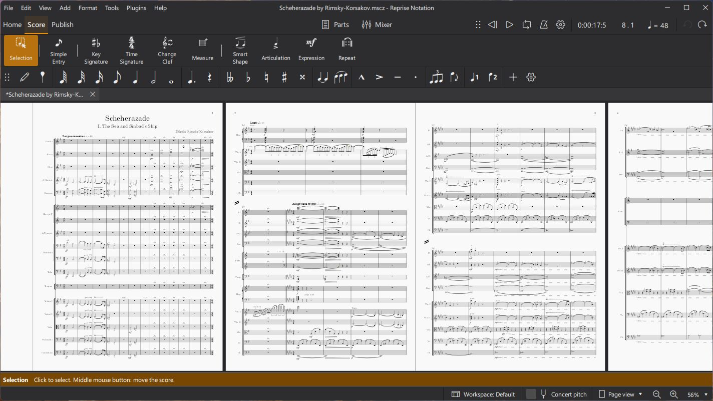
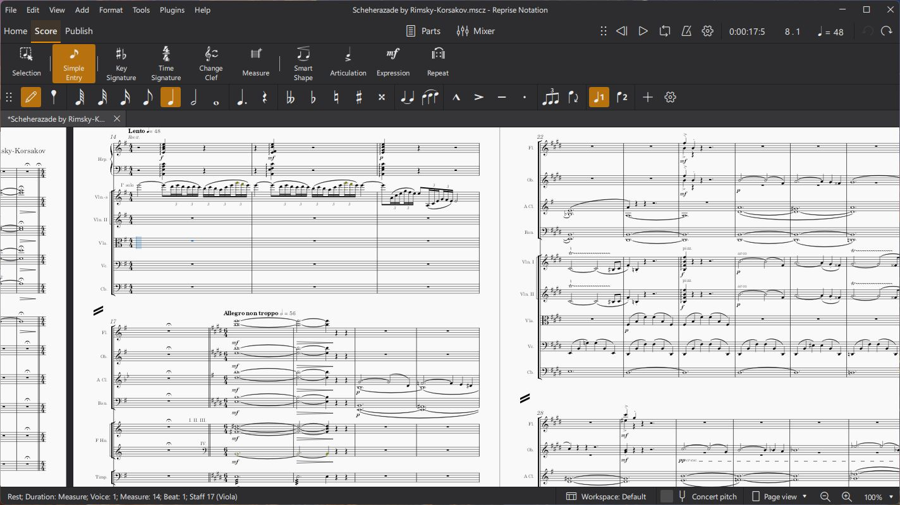
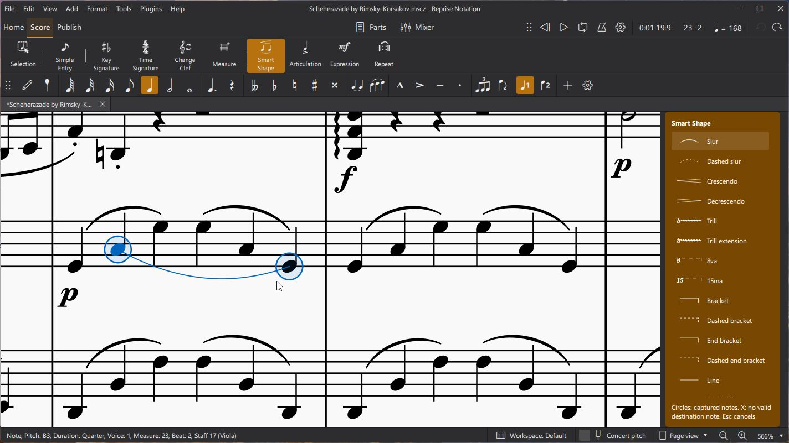
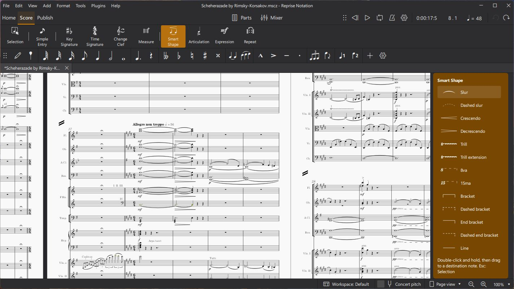
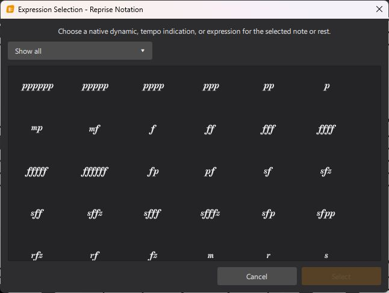
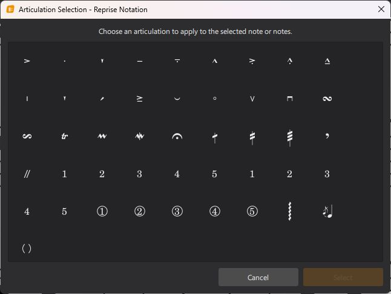
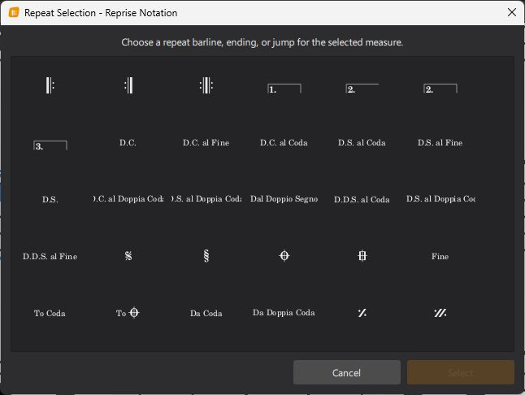

# Reprise Notation

**Reprise Notation is an open-source music notation app for Windows. It brings familiar Finale workflows to MuseScore Studio’s notation and playback engine.**

When [MakeMusic ended development of Finale](https://www.finalemusic.com/blog/end-of-finale-new-journey-dorico-letter-from-president/), musicians, arrangers, and copyists who relied on it had to consider a different notation app. Reprise Notation is designed to make that transition easier. Its tools and gestures draw on Finale while keeping the score layout, playback, and editing features of [MuseScore Studio](https://musescore.org/).

## Enter and edit notes

Use **Simple Entry** to write notes, and switch tools to change key signatures, time signatures, or clefs. The tips panel explains how to use the active tool.

## Draw a slur on the score

In **Smart Shape**, choose **Slur**, double-click the starting note, and hold the second click while dragging to the destination note. The preview shows the curve and highlights both notes before you release. The Smart Shape panel also contains hairpins, trills, octave lines, and brackets.

See the Smart Shape panel

## Choose expressions, articulations, and repeats

Use the dedicated dialogs to choose dynamics and tempo markings, apply articulations, or add repeat barlines, endings, and jumps.

| Expressions | Articulations | Repeats |
| --- | --- | --- |
|  |  |  |

*Screenshots show Scheherazade by Nikolai Rimsky-Korsakov.*

## Bring over a score from Finale

Export the score as **MusicXML** in Finale, then open it in Reprise Notation. Review the layout after importing.

## Availability and feedback

The Windows release is planned for the Microsoft Store. [Project website](https://emanuelecampilongo.com/software/reprise-notation)

Send bug reports, feature suggestions, and proposed code changes to [info@emanuelecampilongo.com](mailto:info@emanuelecampilongo.com). To copy the address from the app, open **Help → Feedback…**. See [Contributing to Reprise Notation](CONTRIBUTING.md) for what to include and how to build the app.

## Source code and credits

Reprise Notation is an independent project by [Emanuele Campilongo](https://emanuelecampilongo.com/), based on the work of the [MuseScore Studio project](https://github.com/musescore/MuseScore) and its contributors. The code is distributed under the [GNU General Public License, version 3](LICENSE.txt).

To build the app, see the [MuseScore Studio developer setup guide](https://github.com/musescore/MuseScore/wiki/Set-up-developer-environment) and the [Reprise Notation MSIX packaging instructions](buildscripts/packaging/Windows/REPRISE-DISTRIBUTION.md).

[Reprise Notation Privacy Policy](PRIVACY.md)
